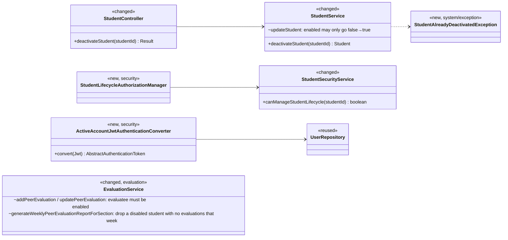
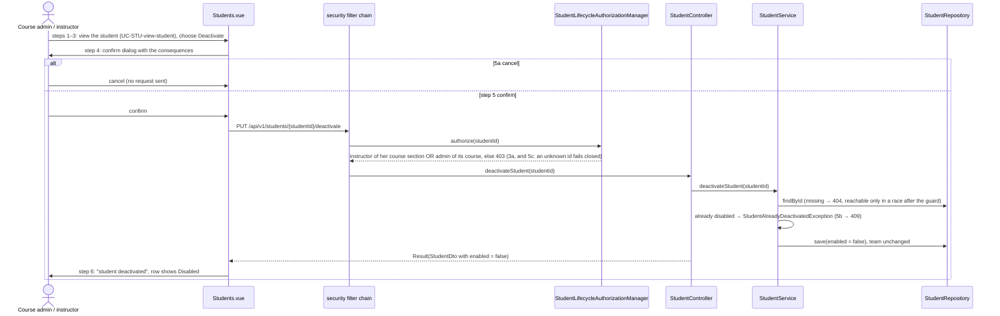
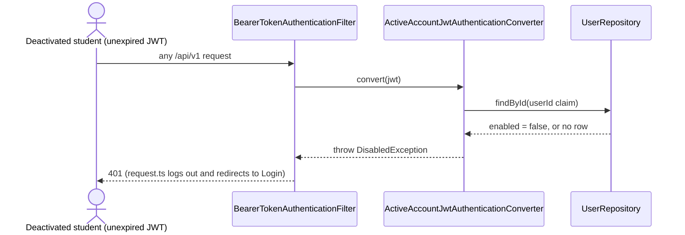

# Student (STU) Design

> Realizes: UC-STU-deactivate-student
> Depends on: FR-SEC-active-account, BR-student-lifecycle, BR-evaluate-active-teammates, BR-section-scoped-access, BR-role-based-access, BR-team-admin-only, BR-submission-owed
> See: [use cases](../requirements/use-cases.md#student), [business rules](../requirements/business-rules.md), [architectural-design.md](architectural-design.md#shared-foundation-components) (shared-foundation component view; [Authentication](architectural-design.md#authentication) and [Authorization](architectural-design.md#authorization) in Crosscutting Concepts)
> Designed against `main` at `59f0267` (2026-11-06).

## Overview

This area covers the student lifecycle in the `student` foundation slice. The other STU use cases (invite, find, view, delete) were built before this workflow and have no design here yet. Deactivation turns off a student's account without removing her or her work (BR-student-lifecycle). It touches three places beyond `student`:

- **`security`:** a new route guard. Also a per-request `enabled` check, so deactivation takes effect on the student's next request rather than when her token expires (FR-SEC-active-account).
- **`evaluation`:** teammates can no longer evaluate her (BR-evaluate-active-teammates).
- **Frontend:** the Students page.

Before this design, a student was deactivated through the generic `PUT /students/{studentId}` `enabled` flag. That path has no confirmation step and no rule for the course admin, and its route guard (`UserOwnershipAuthorizationManager`) also admits the student herself. Until UC-STU-reactivate-student is designed, that PUT keeps only the inactive → active direction (see the use case's Associated Information).

## Components & classes

**Backend**
- `student/StudentController.java`: adds `deactivateStudent`.
- `student/StudentService.java`: adds `deactivateStudent`. `updateStudent` now ignores an `enabled` change from true to false.
- `student/StudentSecurityService.java`: adds `canManageStudentLifecycle`. It is true when the caller's `UserUtils.getUserId()` matches, by id, a member of the student's `section.getInstructors()` (the existing `isCurrentUserInstructorOfStudentSection`) or `section.getCourse().getCourseAdmin()`. It is never true for the student herself. An unknown student returns `false` and never throws. The course section, its course and the course admin are mandatory associations (`@ManyToOne(optional = false)`), so they are not null-checked ([Authorization](architectural-design.md#authorization)).
- `security/authorizationmanagers/StudentLifecycleAuthorizationManager.java`: new, a thin wrapper over that method that reads `studentId`. It is bound in `security/SecurityConfiguration.java`.
- `security/ActiveAccountJwtAuthenticationConverter.java`: new. It wraps the existing `jwtAuthenticationConverter()` bean and is registered on `oauth2ResourceServer().jwt()`. It reads the `userId` claim the same way `UserUtils.getUserId` does (Integer or Long), looks the user up with `UserRepository.findById`, and throws `DisabledException` when the user is missing or disabled. `DisabledException` is an `AuthenticationException`, so the bearer-token entry point answers 401. The filter runs on any request that carries a bearer header, so a stale token is refused even on a `permitAll` route; the SPA then logs out, which is the intended effect.
- `system/exception/StudentAlreadyDeactivatedException.java`: new. `ExceptionHandlerAdvice` maps it to HTTP 409 with `StatusCode.CONFLICT`, following the existing `SectionLockRequiredException` handler.
- `evaluation/EvaluationService.java`: changed, as shown in the class diagram.

**Frontend**
- `utils/request.ts`: adds a per-request `handledStatuses` option. The response interceptor skips its global toast and redirect for the statuses listed there and only rejects the promise, so the caller handles them.
- `apis/student/index.ts`: adds `deactivateStudent(id)`, which passes `handledStatuses: [403, 404, 409]`.
- `pages/students/Students.vue`: every enabled row the list returns gets a Deactivate operation, behind an `ElMessageBox.confirm`. This row action is how steps 2–3 reach the student; no separate details page is needed. The dialog states every consequence in the use case's Associated Information: she can no longer log in or submit weekly activity reports or peer evaluations; her account, her submitted work and her team are kept; teammates cannot evaluate her while she is deactivated; she can be reactivated later; and this is not a delete.
- `pages/students/EditStudentForm.vue`: for an enabled student the Status control is read-only; for a deactivated one it can be switched to Enabled.
- `pages/evaluations/SubmitTeamsEvaluations.vue`: leaves out teammates whose `enabled` is false, both when submitting and when updating. The form sends one request per evaluatee, so leaving her out never fails her teammates' other evaluations. Evaluations of her submitted before she was deactivated stay stored; they are just no longer shown or resubmitted. The server enforces the rule; this only keeps the form honest.

## Sequence

### Deactivate a student (UC-STU-deactivate-student)

Because the call opts out of the global handling for 403, 404 and 409, the view handles all three itself. On a 403 or 404 it shows "This student can no longer be deactivated" and reloads the list (3a and 5c). On a 409 it shows "This student is already deactivated" and reloads the list (5b). Every other error keeps the global handling.

### A deactivated student's next request (FR-SEC-active-account)

A fresh login is already refused: `MyUserPrincipal.isEnabled` raises `DisabledException` during HTTP Basic authentication.

## API contract

| Endpoint or job | Caller (who may) | Request | Success | Errors, by extension |
|---|---|---|---|---|
| `PUT /api/v1/students/{studentId}/deactivate` | an instructor of the student's course section, or the course admin of its course (BR-student-lifecycle) | path `studentId`, no body | `Result` 200, `StudentDto` with `enabled = false` | 3a → 403; 5c → 403 (404 only if the student is deleted between guard and service); 5b → 409; 5a sends no request |
| `PUT /api/v1/students/{studentId}` (changed) | unchanged | unchanged | an `enabled` change from true to false is ignored; other fields are saved | unchanged |
| `POST` / `PUT` peer evaluation (changed) | unchanged | unchanged | unchanged | evaluatee deactivated → 400 (`PeerEvaluationIllegalArgumentException`) |
| every bearer-token request (changed) | — | — | — | account disabled or missing → 401 |

## Key decisions

- **A dedicated action endpoint.** We rejected keeping deactivation in `updateStudent`: that path has no confirmation, has no course-admin rule, and admits the student herself.
- **The generic PUT ignores an `enabled` change from true to false.** We rejected returning 400: the existing edit form sends `enabled` on every save, so a 400 would break ordinary edits until the form changes. *This is the decision most likely to be revisited when UC-STU-reactivate-student is designed.*
- **5c returns 403, not 404.** Guards fail closed and never reveal which ids exist ([Authorization](architectural-design.md#authorization)), so an unknown id is denied like an unpermitted one. We rejected a guard that returns 404, because it would answer "does student N exist?" for any instructor.
- **5b returns 409, not an idempotent 200.** Step 6 tells the user "this student has been deactivated", and that should never report a change this request didn't make. We rejected treating it as idempotent.
- **`enabled` is re-checked on every request inside the JWT converter.** This realizes FR-SEC-active-account as written ("regardless of otherwise-valid credentials"). The cost is one primary-key read per authenticated request.
  - Rejected: a token blocklist. It is stateful and still needs a read per request.
  - Rejected: shorter-lived tokens. They still leave a window.
  - The check also covers instructors, so UC-INS-deactivate-instructor inherits it.
- **Peer-evaluation enforcement ships with this use case**, not later with EVA. Otherwise the first deactivation would break BR-evaluate-active-teammates. `evaluation` reads `Student.isEnabled()`, which is a foundation read that `MNT-feature-locality` permits.
- **Students.vue handles these errors itself, using a per-request opt-out in `request.ts`.** We rejected letting the global interceptor redirect to the forbidden or not-found page: 5c requires the user to stay on the list and see it refreshed. We also rejected special-casing this URL inside the interceptor, which would hide feature logic in shared plumbing. The opt-out leaves every other caller unchanged.
- **The course-section report decides what "evaluated" means.** It lists a deactivated student for a week only when that week has at least one evaluation with her as the evaluatee and a teammate other than herself as the evaluator. This follows BR-evaluate-active-teammates' "at least one teammate". Only the course-section report changes: the per-student report (UC-EVA-student-evaluation-report) shows whatever evaluations of her exist.
- **The student stays on her team.** Team membership changes only under BR-team-admin-only. Owed submissions need no change. `notification/SubmissionStatusService.findOwedItems` already keeps only active students, both as students who owe submissions and as the teammates each of them must evaluate. So a deactivated student owes nothing, and her teammates stop owing an evaluation of her.

## Data model

There is no schema change. `enabled` already exists on `PeerEvaluationUser` (see the SRS Business Domain Model). We record no audit of who deactivated whom; we rejected adding one because no requirement asks for it.

## Tests

| Use case, flow | Level (unit / integration) | Asserts |
|---|---|---|
| UC-STU-deactivate-student, main: an instructor of the course section deactivates | unit (`StudentServiceTest`) + integration (`StudentIntegrationTest`) | 200, `enabled = false` persisted, team unchanged |
| UC-STU-deactivate-student, main: a course admin not assigned to the course section deactivates | integration | 200 |
| FR-SEC-active-account: a deactivated student's unexpired token | integration | 401 on her next request; a fresh login also gets 401 |
| UC-STU-deactivate-student, 3a: an instructor of another course section | integration | 403, account still enabled |
| UC-STU-deactivate-student, 3a: a student targets herself or a teammate | integration | 403 |
| UC-STU-deactivate-student, 5a: cancel at confirmation | E2E (Cypress) | no `PUT …/deactivate` is sent; the row still shows Enabled |
| UC-STU-deactivate-student, 5b: already deactivated | unit + integration | 409, nothing changes |
| UC-STU-deactivate-student, 5c: no such student | integration | 403 |
| Generic PUT: interim reactivation path | unit + integration | a true → false change is ignored; false → true is applied |
| BR-evaluate-active-teammates: submit or edit an evaluation of a deactivated teammate | unit (`EvaluationServiceTest`) + integration | 400, nothing saved |
| BR-evaluate-active-teammates: the course-section report | unit | a deactivated student is absent in a week with no evaluations of her, and present in a week with some |
| BR-evaluate-active-teammates: earlier work and team kept | integration | after deactivation, her earlier evaluations still exist and she is still on her team |
| BR-evaluate-active-teammates: evaluable again after reactivation | integration | after reactivation through the generic PUT, an evaluation of her is accepted |

## Open questions / risks

- The per-request `enabled` read adds one database read to every authenticated request. That is fine at the scale `SCA-cohort-load` describes; add caching only if a `PER-*` threshold is at risk.
- The use case doesn't say whether the student should be emailed when she is deactivated (reactivation does email her), so this design doesn't email her.
- Out of scope: the authorization on `DELETE /students/{studentId}` does not match BR-student-lifecycle (OI-65).
- The interim reactivation path keeps the generic PUT's existing guard (`UserOwnershipAuthorizationManager`). That guard admits an instructor of the student's course section but not an unassigned course admin, so until UC-STU-reactivate-student is designed, an unassigned course admin cannot reactivate.
- Test fixtures: `DataInitializer` is unchanged. The integration tests build the states the seed lacks inside their own rolled-back transaction: they unassign the course admin from the student's course section, or disable a student, through the repositories. An admin of another course (Tim) serves as the instructor of another course section, and the evaluation window is opened with the spied `Clock`.
- 5a is an E2E test in the existing Cypress suite (`frontend/cypress/e2e`), since the frontend has no component-test runner.
